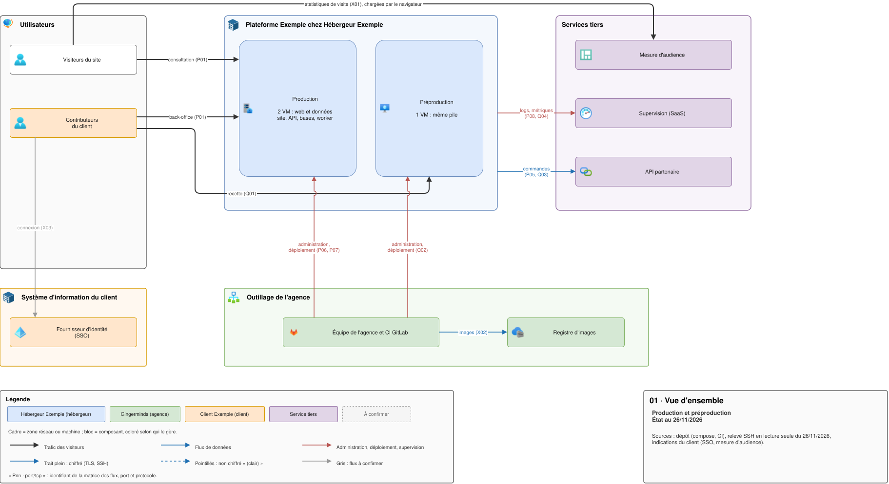
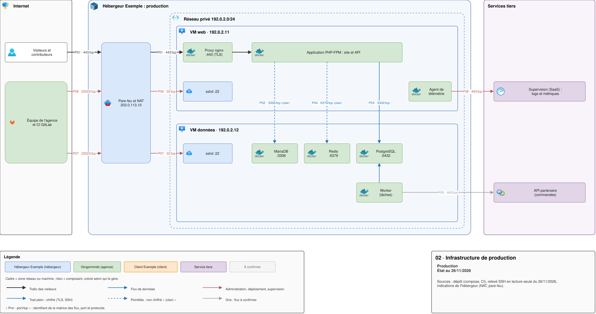
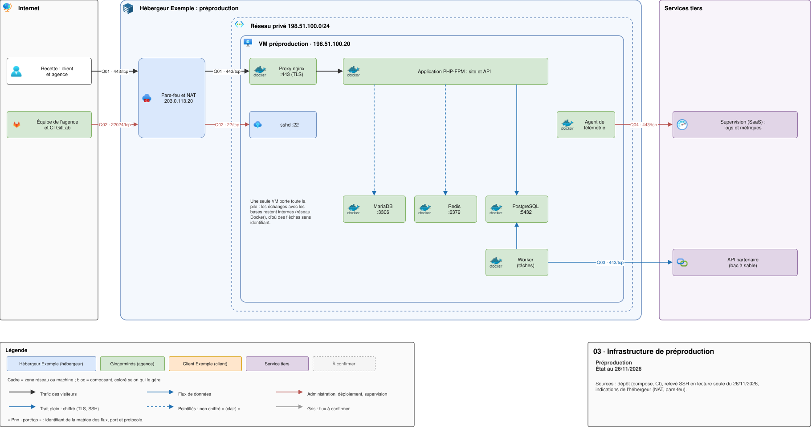

# Architecture technique

Documentation de référence de l'architecture technique de la plateforme Exemple (site et API) : hébergement, réseau, flux et accès, en production comme en préproduction. Elle s'adresse à l'équipe de l'agence (développement, exploitation) comme au client, qui y trouve la référence de son infrastructure.

Exemple fictif fourni avec le skill `/gm:technical-architecture` : noms inventés, adresses réservées à la documentation (RFC 5737).

Chaque vue répond à une question et porte sa date (« État au ») : elle ne montre que ce qui a été constaté, décidé ou indiqué, et marque le reste « à confirmer ». Le détail exhaustif des flux est dans la [matrice des flux](#matrice-des-flux), dont les identifiants (`P01`, `Q02`...) figurent sur les flèches.

## Vues

| Vue | Question à laquelle elle répond |
|-----|---------------------------------|
| [01 · Vue d'ensemble](views/01-vue-ensemble.drawio.svg) | Qui utilise la plateforme, et avec quels systèmes échange-t-elle ? |
| [02 · Infra prod](views/02-infra-prod.drawio.svg) | Comment la production est-elle hébergée, et comment les flux y circulent-ils ? |
| [03 · Infra preprod](views/03-infra-preprod.drawio.svg) | En quoi la préproduction diffère-t-elle de la production ? |

### 01 · Vue d'ensemble

Pour tout lecteur, sans adresse ni port : utilisateurs, plateforme et ses deux environnements, système d'information du client, outillage de l'agence et services tiers.

### 02 · Infra prod

Deux VM derrière le pare-feu et le NAT de l'hébergeur : la VM web porte le proxy, l'application et l'agent de télémétrie, la VM données porte les bases et le worker.

### 03 · Infra preprod

Même disposition que la vue prod, pour comparer d'un coup d'œil : une seule VM porte toute la pile, donc les échanges avec les bases restent internes à la VM.

## Légende

Chaque vue porte sa propre légende ; elle est reprise ici.

- **Couleur d'un bloc = qui le gère** : bleu pour l'hébergeur (réseau, pare-feu, VM), vert pour l'agence (conteneurs, configuration, déploiement), orange pour le client (système d'information, utilisateurs), violet pour un service tiers.
- **Gris en pointillés** : élément ou flux à confirmer.
- **Cadres** : zones réseau et machines (VM), imbriquées ; les blocs à l'intérieur d'une VM sont ses conteneurs ou services.
- **Pictogrammes** : utilisateurs, Internet, réseau, VM, conteneur Docker, accès SSH (`sshd :22`). Les autres pictogrammes illustrent le bloc qu'ils accompagnent (pare-feu, supervision, API...).
- **Couleur d'une flèche = nature du flux** : noir pour le trafic des visiteurs, bleu pour les flux de données, rouge pour l'administration, le déploiement et la supervision, gris pour un flux à confirmer.
- **Trait plein** : flux chiffré (TLS, SSH). **Pointillés et mention « (clair) »** : flux non chiffré.
- **Étiquette d'une flèche** : identifiant de la matrice des flux, port et protocole (« P02 · 3306/tcp (clair) »). Les flèches sans identifiant sont des échanges internes à une VM, sur le réseau Docker.
- **Arc sur une flèche** : deux flux qui se croisent sans se rejoindre.
- **Cartouche** : titre, environnement, date de l'état décrit (« État au »), sources.

## Matrice des flux

Une ligne par flux qui traverse une frontière de machine (les échanges internes à une VM, sur le réseau Docker, sont dessinés sans identifiant). Identifiants stables : `P` pour la production, `Q` pour la préproduction, `X` pour ce qui ne dépend pas d'un environnement. Un numéro n'est jamais réattribué : un flux supprimé laisse son numéro libre.

Statuts : `constaté (JJ/MM/AAAA)`, `décidé`, `indiqué par <qui> (JJ/MM/AAAA)`, `à confirmer`.

### Production

| # | Source | Destination | Port / protocole | Chiffré | Authentification | Finalité | Géré par | Statut |
|---|--------|-------------|------------------|---------|------------------|----------|----------|--------|
| P01 | Visiteurs et contributeurs (Internet) | Proxy nginx, VM web, par le NAT `203.0.113.10` | `443/tcp` HTTPS | oui (TLS) | aucune ; back-office par SSO (`X03`) | accès au site et à l'API | Hébergeur Exemple (NAT), Gingerminds (proxy) | constaté (26/11/2026) |
| P02 | Application, VM web `192.0.2.11` | MariaDB, VM données `192.0.2.12` | `3306/tcp` MySQL | non | compte applicatif | données du site | Gingerminds | constaté (26/11/2026) |
| P03 | Application, VM web | PostgreSQL, VM données | `5432/tcp` PostgreSQL | oui (TLS) | compte applicatif | données de l'API | Gingerminds | constaté (26/11/2026) |
| P04 | Application, VM web | Redis, VM données | `6379/tcp` Redis | non | secret partagé dans la configuration | cache et sessions | Gingerminds | constaté (26/11/2026) |
| P05 | Worker, VM données | API partenaire (Internet) | `443/tcp` HTTPS | oui (TLS) | clé d'accès du partenaire | envoi des commandes | Gingerminds | à confirmer |
| P06 | Équipe de l'agence et CI GitLab | sshd, VM web, par le NAT `203.0.113.10` | `22022/tcp` SSH, translaté vers `22/tcp` | oui (SSH) | clé SSH | administration et déploiement | Hébergeur Exemple (NAT), Gingerminds | constaté (26/11/2026) |
| P07 | Équipe de l'agence | sshd, VM données, par le NAT `203.0.113.10` | `22023/tcp` SSH, translaté vers `22/tcp` | oui (SSH) | clé SSH | administration | Hébergeur Exemple (NAT), Gingerminds | constaté (26/11/2026) |
| P08 | Agent de télémétrie, VM web | Supervision (SaaS) | `443/tcp` HTTPS | oui (TLS) | clé du service de supervision | logs et métriques | Gingerminds | indiqué par l'hébergeur (20/11/2026) |

### Préproduction

| # | Source | Destination | Port / protocole | Chiffré | Authentification | Finalité | Géré par | Statut |
|---|--------|-------------|------------------|---------|------------------|----------|----------|--------|
| Q01 | Recette : client et agence (Internet) | Proxy nginx, VM préproduction, par le NAT `203.0.113.20` | `443/tcp` HTTPS | oui (TLS) | authentification HTTP basique | recette | Hébergeur Exemple (NAT), Gingerminds (proxy) | constaté (26/11/2026) |
| Q02 | Équipe de l'agence et CI GitLab | sshd, VM préproduction `198.51.100.20`, par le NAT `203.0.113.20` | `22024/tcp` SSH, translaté vers `22/tcp` | oui (SSH) | clé SSH | administration et déploiement | Hébergeur Exemple (NAT), Gingerminds | constaté (26/11/2026) |
| Q03 | Worker, VM préproduction | API partenaire, bac à sable | `443/tcp` HTTPS | oui (TLS) | clé d'accès de test | essais d'envoi des commandes | Gingerminds | décidé |
| Q04 | Agent de télémétrie, VM préproduction | Supervision (SaaS) | `443/tcp` HTTPS | oui (TLS) | clé du service de supervision | logs et métriques | Gingerminds | constaté (26/11/2026) |

### Hors environnement

| # | Source | Destination | Port / protocole | Chiffré | Authentification | Finalité | Géré par | Statut |
|---|--------|-------------|------------------|---------|------------------|----------|----------|--------|
| X01 | Navigateur des visiteurs | Mesure d'audience (service tiers) | `443/tcp` HTTPS | oui (TLS) | aucune | statistiques de visite | Client Exemple | indiqué par le client (18/11/2026) |
| X02 | CI GitLab | Registre d'images de l'agence | `443/tcp` HTTPS | oui (TLS) | identifiant de la CI | publication des images | Gingerminds | constaté (26/11/2026) |
| X03 | Contributeurs du client | Fournisseur d'identité du client (SSO) | `443/tcp` HTTPS | oui (TLS) | SSO OpenID Connect | connexion au back-office | Client Exemple | à confirmer |

## Points d'attention connus

État au 26/11/2026. Une ligne par point : ce qui est constaté (ou indiqué), son effet, et les flux concernés.

| # | Constat | Effet | Détail |
|---|---------|-------|--------|
| A01 | MariaDB et Redis sans TLS entre la VM web et la VM données | identifiants et données circulent en clair sur le réseau privé de l'hébergeur ; la protection repose sur son cloisonnement | `P02`, `P04` |
| A02 | Envoi des commandes à l'API partenaire non vérifié en production : ni observé sur le serveur, ni décrit par la configuration de production du dépôt | une panne de l'envoi passerait inaperçue tant que le flux n'est pas confirmé et supervisé | `P05` |

## Modifier un schéma

Les vues sont des fichiers `.drawio.svg` : des images SVG qui embarquent leur diagramme draw.io. Les forges (GitLab, GitHub) les affichent comme des images, et draw.io les ouvre et les enregistre telles quelles.

- **À la souris** : ouvrir le fichier dans draw.io (application de bureau, ou [diagrams.net](https://app.diagrams.net) via *Fichier > Ouvrir depuis > Appareil*), modifier, puis enregistrer au même format, en gardant une copie du diagramme et en incorporant les images.
- **Texte simple** : les libellés sont en texte simple (option *Texte formaté* décochée, onglet *Texte* du panneau *Format*). Un libellé en texte formaté fait embarquer par draw.io une image de secours dans le SVG et rend le texte moins fiable à l'impression.
- **Pictogrammes** : ils viennent des bibliothèques intégrées de draw.io et font partie de leur bloc. Pour un nouveau bloc avec pictogramme, copier un bloc existant puis changer son texte.
- **En éditant le XML** (cas de Claude) : `python3 docs/architecture/tools/architecture.py extract <vue> <source.drawio>`, modifier la source, puis `python3 docs/architecture/tools/architecture.py render <source.drawio> <vue>`.
- **Ensuite, toujours** : `make diagrams`. La cible régénère les images (draw.io dans Docker, rien à installer) et vérifie que chaque vue a son cartouche et sa légende, que chaque identifiant de flux d'une vue figure dans la matrice et inversement, que les statuts sont valides, et qu'aucun secret ni image externe ne s'est glissé dans les vues.

Règles :

- Une vue et la matrice se mettent à jour **dans le même changement** (commit, MR) que l'infrastructure, le déploiement ou le flux qu'elles décrivent, et la date du cartouche avec elles.
- Aucun secret (mot de passe, jeton, clé) : les adresses, ports, noms d'hôtes et comptes de service sont acceptés.
- Ce qui n'est pas confirmé reste marqué « à confirmer », jamais deviné.

Dossier PDF : `make architecture-pdf` le génère à la demande dans `docs/architecture/build/`, qui n'est pas versionné. Il réunit une page de titre, une vue par page, puis la légende, la matrice des flux (sans la colonne statut) et les points d'attention connus. `make architecture-pdf SANS_POINTS_ATTENTION=1` produit la variante sans les points d'attention, à transmettre hors de l'équipe.

Outillage : `docs/architecture/tools/architecture.py` (Python 3.9 ou plus, bibliothèque standard), réglé par `docs/architecture/tools/architecture.json` (titre, nom du PDF, préfixes des flux, noms des acteurs).
